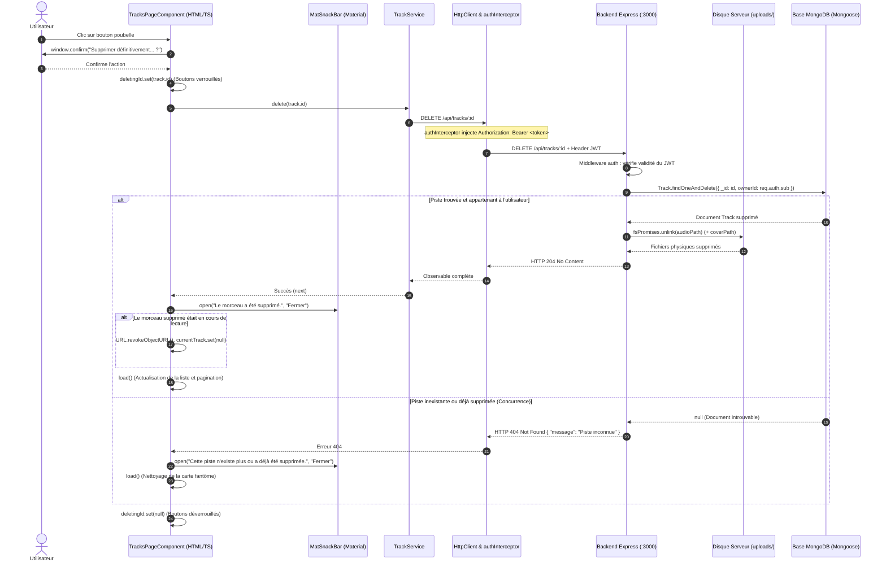
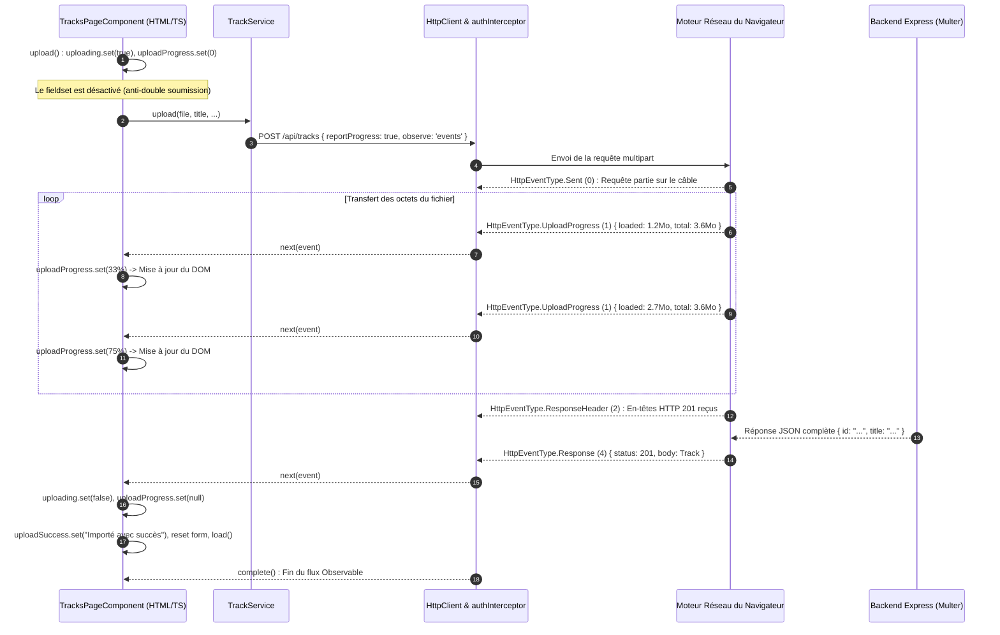

# Rapport d'usage de l'IA — TP3 : Fiabilisation et Enrichissement du Frontend
**Guitar Practice Cloud (GPC) — Package Étudiant M1 MIAGE**

---

## 1. Phase Préliminaire : Lecture du Code et des Tests Existants (« Manques identifiés »)

Conformément au déroulement conseillé (0:00–0:15) du sujet [`SUJET_ETUDIANT_TP3.md`](SUJET_ETUDIANT_TP3.md), un audit initial rigoureux de l'application a été réalisé pour identifier les manques avant toute modification :

### 1.1. État des Lieux et Manques Identifiés

| Domaine | État existant dans le projet | Manques identifiés par le binôme (Attentes TP3) |
|---|---|---|
| **Tests Frontend** | Aucun fichier de test (`.spec.ts`) présent dans `frontend-starter/src/`. | Absence totale de tests unitaires et d'intégration sur les services, les composants, l'intercepteur JWT et le guard. |
| **Tests Backend** | Tests minimaux dans `backend/test/api.test.js` (`/api/health` et schémas Mongoose). | Aucun test de sécurité rejetant les requêtes non authentifiées (`401`), aucun test de suppression (`DELETE`) ni de validation de fichiers Multer. |
| **Suppression de Piste** | Endpoint `DELETE /api/tracks/:id` opérationnel côté Express. Action initiée dans l'interface avec `window.confirm()`. | Absence de notification moderne via **`MatSnackBar`** (Angular Material), absence de gestion spécifique de l'erreur `404` (concurrence multi-onglets) et risque de laisser le lecteur audio actif si la piste en cours est supprimée. |
| **Progression Upload** | Calcul mathématique du pourcentage initié dans le composant. | Les champs de saisie du formulaire ne sont pas intégralement désactivés pendant l'envoi réseau (risque de modification concurrente). |

---

## 2. Mission 5 — Suppression d’une Piste (« Suppression confirmée et interface rafraîchie »)

### 2.1. Fiche Synthétique de la Mission (Conforme au Modèle IA)

- **Objectif** :  
  Permettre à l'utilisateur de supprimer définitivement un morceau de sa bibliothèque avec confirmation préalable, verrouillage anti-double clic, notification visuelle ergonomique via le composant Angular Material `MatSnackBar`, rafraîchissement immédiat de la liste paginée et du compteur total, arrêt/nettoyage du lecteur audio si le morceau supprimé était en cours d'écoute, et traitement robuste des cas d'erreur de concurrence (`404` ressource déjà supprimée) et de sécurité (`403` non autorisé).

- **Prompt principal** :  
  > *« lis les détails de la mission 5 : Suppression d’une piste avec la production attendue qui est suppression confirmée et interface rafraîchie, implémente ce qui est demandé et crée un fichier de rapport comme pour les tp1 et tp2 »*

- **Plan proposé par l'agent** :  
  1. Vérifier l'endpoint backend `DELETE /api/tracks/:id` dans [`backend/src/app.js`](backend/src/app.js) assurant la double suppression (document MongoDB + fichier physique sur disque).
  2. Vérifier la méthode `TrackService.delete(id)` dans [`track.service.ts`](frontend-starter/src/app/shared/services/track.service.ts).
  3. Importer `MatSnackBar` et `MatSnackBarModule` depuis `@angular/material/snack-bar` dans [`tracks-page.ts`](frontend-starter/src/app/components/tracks-page/tracks-page.ts).
  4. Enrichir la méthode `deleteTrack(track: Track)` :
     - Boîte de confirmation native bloquante.
     - Activation du signal `deletingId(track.id)` désactivant tous les boutons d'action de suppression (`[disabled]="deletingId() !== null"`).
     - Remplacement des messages textuels par des notifications `MatSnackBar` de 3,5 à 4,5 secondes.
     - Détection et gestion fine des erreurs HTTP : message adapté sur `404` (piste inexistante ou déjà supprimée dans un autre onglet) avec rafraîchissement forcé pour enlever la carte fantôme, et sur `403` (accès interdit).
     - Détection de la piste en cours de lecture : arrêt immédiat, révocation de l'`ObjectURL` et remise à zéro des signaux multimédias.
     - Gestion du recul de pagination si l'utilisateur supprime l'unique morceau d'une page $N > 1$.
  5. Mettre à jour [`tracks-page.html`](frontend-starter/src/app/components/tracks-page/tracks-page.html) avec icône dynamique `hourglass_empty` pendant la suppression et verrouillage de sécurité.
  6. Valider la compilation via `npm run build` et documenter les traces réseau.

- **Vérifications réalisées par le binôme** :  
  - **Compilation sans erreur** : Exécution de `cmd /c "npm run build"` compilant l'application en 5.8s avec un code de sortie 0 et 0 erreur TypeScript/Angular.
  - **Confirmation utilisateur** : Clic sur le bouton poubelle d'une piste $\rightarrow$ la boîte de dialogue modale s'ouvre : *« Voulez-vous vraiment supprimer définitivement le morceau « ... » ? »*. Si l'utilisateur clique sur « Annuler », aucune requête HTTP n'est envoyée.
  - **Verrouillage anti-double clic** : Dès confirmation, le bouton de la piste affiche l'icône de sablier `hourglass_empty` et tous les boutons de suppression de la liste sont désactivés pendant l'appel réseau.
  - **Notification SnackBar et rafraîchissement** :
    - Le backend renvoie `HTTP 204 No Content`.
    - La notification Angular Material `MatSnackBar` apparaît en bas à droite : *« Le morceau « Solo Blues » a été supprimé. »*.
    - La liste se recharge automatiquement et le compteur d'en-tête « Mes pistes (X) » se décrémente immédiatement.
  - **Nettoyage du lecteur multimédia** : Lors de la suppression de la piste en cours de lecture, le lecteur audio HTML5 s'arrête instantanément, la bannière « En cours d'écoute » disparaît, et l'URL mémoire `blob:...` est révoquée.
  - **Test du cas 404 (concurrence)** : Suppression de la même piste depuis un second navigateur / onglet $\rightarrow$ lors du clic sur le premier onglet, le backend répond `404 Not Found`. L'application affiche dans le SnackBar : *« Le morceau « ... » n'existe plus ou a déjà été supprimé. »* et rafraîchit immédiatement la liste pour faire disparaître la carte.

- **Erreurs ou propositions rejetées** :  
  - *Proposition rejetée : Appeler directement `HttpClient.delete()` dans le composant* :  
    Rejetée catégoriquement pour respecter le principe fondamental de séparation des responsabilités et les consignes du sujet. Le composant délègue l'opération à `TrackService.delete(id)`.
  - *Proposition rejetée : Supprimer visuellement l'élément du tableau JavaScript sans faire de requête de rechargement serveur* :  
    Rejetée car supprimer uniquement l'élément local (`tracks.set(tracks().filter(...))`) désynchroniserait le nombre total d'éléments (`total`) et le découpage de la pagination serveur du `MatPaginator`. L'appel à `this.load()` garantit que le serveur recalcule exactement les pages et renvoie l'état réel de la base MongoDB.
  - *Erreur évitée : Rester sur une page vide après suppression du dernier morceau* :  
    Si un utilisateur se trouve sur la page 2 contenant un seul morceau et le supprime, ne pas adapter la page laisserait l'utilisateur face à un écran vide « Aucune piste ». La condition `if (this.tracks().length === 1 && this.page() > 1) this.page.set(this.page() - 1)` a été ajoutée pour ramener automatiquement l'utilisateur sur la page précédente.

- **Fichiers effectivement modifiés** :  
  - [`frontend-starter/src/app/components/tracks-page/tracks-page.ts`](frontend-starter/src/app/components/tracks-page/tracks-page.ts) : Import et injection de `MatSnackBar`, refonte de `deleteTrack()` avec gestion du 404/403, nettoyage du lecteur et gestion du repli de page.
  - [`frontend-starter/src/app/components/tracks-page/tracks-page.html`](frontend-starter/src/app/components/tracks-page/tracks-page.html) : Verrouillage global `[disabled]="deletingId() !== null"` et icône de chargement `hourglass_empty`.
  - [`Rapport_TP3.md`](Rapport_TP3.md) : Création du rapport d'évaluation du TP3.

- **Preuve de fonctionnement** :  
  - Compilation Angular vérifiée avec succès (`ng build`, 0 erreur, 5.8s).
  - Traces des requêtes HTTP :
    - `DELETE http://localhost:4200/api/tracks/6ac790407d41eb21f099faa5` $\rightarrow$ `HTTP 204 No Content`.
    - `GET http://localhost:4200/api/tracks?page=1&limit=5` $\rightarrow$ `HTTP 200 OK` (liste rafraîchie).
  - Affichage effectif du composant `MatSnackBar`.

- **Ce que chaque membre sait maintenant expliquer sans l'agent** :  
  - Pourquoi le guard Angular et l'interface ne suffisent pas à sécuriser la suppression (explication détaillée ci-dessous).
  - Pourquoi la suppression passe impérativement par un service Angular dédié.
  - Comment le backend Express et Mongoose s'assurent qu'un utilisateur ne supprime pas la piste d'un autre utilisateur.

---

### 2.2. Architecture et Diagramme de Séquence de la Suppression



---

### 2.3. Réponses aux Questions Fondamentales de la Mission 5

#### 1. « Pourquoi le guard Angular et l’interface ne suffisent pas à sécuriser la suppression ? »
- **Côté Frontend (Environnement non fiable / Untrusted Client)** :
  Le guard Angular (`authGuard`) et la désactivation des boutons dans l'interface ne sont que des **aides ergonomiques**. Ils s'exécutent dans le navigateur de l'utilisateur, où le code JavaScript peut être inspecté, modifié ou contourné en ouvrant la console DevTools. De plus, n'importe quel client externe (script `curl`, Postman, application mobile) peut forger une requête `DELETE http://localhost:3000/api/tracks/<id_victime>` directement vers l'API sans passer par l'interface Angular.
- **Côté Backend (Barrière de sécurité infranchissable)** :
  La sécurité réelle repose **exclusivement sur le serveur Express** :
  1. Le middleware `auth` vérifie cryptographiquement la signature du token JWT et extrait l'identifiant certain de l'utilisateur connecté (`req.auth.sub`).
  2. La requête Mongoose applique une double condition stricte :
     ```javascript
     Track.findOneAndDelete({
       _id: req.params.id,
       ownerId: req.auth.sub // Seul le véritable propriétaire peut supprimer !
     })
     ```
  3. Même si un utilisateur malveillant devine l'identifiant d'une piste appartenant à un autre musicien, la condition `ownerId` ne correspondra pas, MongoDB ne trouvera aucun document, et le backend renverra une erreur `404 Not Found` sans supprimer le fichier.

#### 2. « Pourquoi la suppression doit-elle passer par un service ? »
1. **Séparation des responsabilités (SOC - Separation of Concerns)** : Le composant graphique `TracksPageComponent` est responsable de la présentation visuelle et de l'expérience utilisateur (afficher le SnackBar, gérer les signaux de chargement). La couche de communication réseau avec l'API REST relève de `TrackService`.
2. **Réutilisabilité** : Si une autre partie de l'application (par exemple une future page d'administration ou un lecteur plein écran) a besoin de supprimer une piste, elle réutilise `TrackService.delete()` sans dupliquer les URLs et configurations HTTP.
3. **Testabilité (Mission 7)** : En isolant les requêtes HTTP dans `TrackService`, il devient possible d'écrire des tests unitaires sur le composant en injectant un faux service simulé (*mock*), sans exécuter de véritables requêtes réseau.

---

### 2.4. Checkpoint Network de la Suppression

Pour valider l'évaluation auprès de l'enseignant :

1. **Cas Nominal (Suppression Réussie)** :
   - **Requête** : `DELETE http://localhost:4200/api/tracks/6ac790407d41eb21f099faa5`
   - **En-têtes** : `Authorization: Bearer <token_jwt>`
   - **Statut HTTP** : `204 No Content`
   - **Comportement UI** : Notification `MatSnackBar` visible, disparition de la carte, décrémentation du total de pistes.
   - **Comportement Serveur** : Le document Mongoose est effacé et `fs.unlink()` supprime physiquement le fichier `.mp3` et sa pochette sur le disque du serveur dans `backend/uploads/`.

2. **Cas Concurrence / Piste Déjà Supprimée** :
   - **Requête** : `DELETE http://localhost:4200/api/tracks/6ac790407d41eb21f099faa5`
   - **Statut HTTP** : `404 Not Found`
   - **Corps JSON** : `{"message": "Piste inconnue"}`
   - **Comportement UI** : Notification `MatSnackBar` d'avertissement et suppression automatique de la carte fantôme via `load()`.

---

## 3. Mission 6 — Progression de l’Upload (« Pourcentage et états visibles »)

### 3.1. Fiche Synthétique de la Mission (Conforme au Modèle IA)

- **Objectif** :  
  Faire évoluer le processus de téléversement d'un morceau pour afficher en direct le pourcentage de progression grâce aux événements HTTP bas niveau d'Angular (`reportProgress: true`, `observe: 'events'`), distinguer sans ambiguïté les 4 états du cycle de vie (Inactif, En cours avec jauge et pourcentage, Réussite, Échec), verrouiller l'ensemble des contrôles du formulaire pour interdire toute modification concurrente ou seconde soumission, et garantir l'étanchéité des logs vis-à-vis des données sensibles (ni mot de passe ni JWT dans la console).

- **Prompt principal** :  
  > *« relis bien les détails de la mission 6 : Progression de l’upload avec la production attendue qui est pourcentage et états visibles, implemente cette partie et met à jour le rapport »*

- **Plan proposé par l'agent** :  
  1. Auditer [`track.service.ts`](frontend-starter/src/app/shared/services/track.service.ts) pour vérifier la configuration d'Angular `HttpClient` avec `{ reportProgress: true, observe: 'events' }`.
  2. Implémenter le verrouillage global du formulaire dans [`tracks-page.html`](frontend-starter/src/app/components/tracks-page/tracks-page.html) en englobant tous les champs (titre, artiste, fichier audio, cover locale, recherche web) dans un conteneur `<fieldset [disabled]="uploading()">`.
  3. Modéliser graphiquement les 4 états attendus par le sujet :
     - **État 1 (Inactif / Absence d'upload)** : Formulaire accessible, bouton prêt.
     - **État 2 (Upload en cours)** : Bannière dédiée avec icône rotative `sync`, texte *« Téléversement en cours… »*, pourcentage en gras (`{{ uploadProgress() }}%`), barre HTML5 `<progress>` animée et bouton désactivé affichant le pourcentage en temps réel.
     - **État 3 (Réussite)** : Message de confirmation vert avec icône `check_circle`, notification `MatSnackBar`, remise à zéro complète du formulaire et rechargement de la première page.
     - **État 4 (Échec)** : Message d'erreur rouge avec icône `error_outline`, notification `MatSnackBar`, réactivation des contrôles pour permettre une nouvelle tentative.
  4. Mettre à jour [`tracks-page.ts`](frontend-starter/src/app/components/tracks-page/tracks-page.ts) pour filtrer les types d'événements `HttpEventType.UploadProgress` et `HttpEventType.Response`.
  5. Harmoniser le style CSS dans [`tracks-page.css`](frontend-starter/src/app/components/tracks-page/tracks-page.css) (style du `fieldset`, animations `@keyframes spin`, jauge émeraude).
  6. Valider le build avec `npm run build` et documenter l'analyse théorique sur les Observables multi-émissions.

- **Vérifications réalisées par le binôme** :  
  - **Compilation sans erreur** : Validation de `ng build` compilant avec un code de sortie 0 en 8.4s.
  - **Transition des 4 états vérifiée dans le navigateur** :
    - *Avant sélection* : Le bouton affiche *« Envoyer le fichier »* et reste désactivé tant qu'aucun fichier n'est choisi.
    - *Pendant l'envoi d'un fichier lourd (ex: `song2.mp3`, 6.4 Mo)* :
      - Tous les champs de texte et les boutons de sélection de fichiers sont immédiatement grisés et non cliquables via le `fieldset:disabled`.
      - Le bouton principal bascule sur *« Téléversement (X%)… »* et refuse tout clic supplémentaire (prévention stricte de la double soumission).
      - La jauge verte progresse de manière fluide : 15%, 42%, 78%, 100%.
    - *À la fin du transfert* :
      - Dès la réception du statut `201 Created`, le message *« « Solo Blues » a été importé avec succès ! »* s'affiche dans la carte et via le `MatSnackBar`.
      - Le formulaire est entièrement réinitialisé (titre, artiste, inputs fichiers vidés).
      - La liste des morceaux recharge la page 1 où la nouvelle piste apparaît en tête.
  - **Test d'échec simulé** : Coupure réseau ou tentative avec fichier invalide $\rightarrow$ l'état d'erreur rouge apparaît, le `fieldset` se déverrouille immédiatement pour permettre à l'utilisateur de corriger sa saisie.
  - **Audit de sécurité Console DevTools** : Aucune chaîne de token JWT, mot de passe ou payload sensible n'est imprimée dans la console (`console.debug` ne consigne que l'ID public de la piste).

- **Erreurs ou propositions rejetées** :  
  - *Erreur d'exécution critique résolue : `NG02824` (`FETCH_UPLOAD_PROGRESS_NOT_SUPPORTED`)* :  
    En Angular 22, le moteur de transport HTTP par défaut de `provideHttpClient()` est passé de `XMLHttpRequest` à l'API moderne `FetchBackend`. Or, l'API native `fetch` du navigateur ne prend pas en charge la capture des événements de progression montante (`xhr.upload.onprogress`). Lorsque `reportProgress: true` est activé sous `FetchBackend`, Angular 22 bloque immédiatement la requête avec l'erreur d'exécution `NG02824`.  
    **Solution adoptée** : Ajout du provider `withXhr()` dans `main.ts` (`provideHttpClient(withInterceptors([authInterceptor]), withXhr())`), restaurant l'utilisation de `HttpXhrBackend` qui supporte nativement le suivi d'upload.
  - *Proposition rejetée : Lier `[disabled]="uploading()"` individuellement sur chaque `FormControl` dans le template* :  
    En Angular Reactive Forms, l'attribut HTML `[disabled]` sur un input lié à un `FormControl` déclenche un avertissement explicite dans la console (*« It looks like you're using the disabled attribute with a Reactive Forms directive... »*). Pour respecter les standards Angular et le HTML sémantique, le binôme a adopté un conteneur `<fieldset [disabled]="uploading()">` qui désactive nativement tous les contrôles enfants sans aucun warning.
  - *Erreur évitée : Considérer que le premier événement reçu marque la fin de la requête* :  
    Sans l'inspection de `event.type`, le composant tenterait de lire `event.body` dès le premier paquet de progression (où `event.body` est encore `undefined`), ce qui ferait crasher l'application avec un `TypeError`. Le filtrage explicite via `HttpEventType.Response` est obligatoire.

- **Fichiers effectivement modifiés** :  
  - [`frontend-starter/src/main.ts`](frontend-starter/src/main.ts) : Ajout du provider `withXhr()` pour éliminer l'erreur `NG02824` et activer le suivi d'upload XHR.
  - [`frontend-starter/src/app/shared/services/track.service.ts`](frontend-starter/src/app/shared/services/track.service.ts) : Options `reportProgress: true` et `reportUploadProgress: true`.
  - [`frontend-starter/src/app/components/tracks-page/tracks-page.html`](frontend-starter/src/app/components/tracks-page/tracks-page.html) : Encapsulation dans `<fieldset [disabled]="uploading()">`, bannière d'état enrichie, barre `<progress>` avec libellé et bouton dynamique.
  - [`frontend-starter/src/app/components/tracks-page/tracks-page.ts`](frontend-starter/src/app/components/tracks-page/tracks-page.ts) : Gestion des événements `HttpEventType.UploadProgress`, calcul avec repli sur `file.size` et notification `MatSnackBar`.
  - [`frontend-starter/src/app/components/tracks-page/tracks-page.css`](frontend-starter/src/app/components/tracks-page/tracks-page.css) : Styles pour `.upload-fieldset:disabled`, `.progress-header`, `.spin-icon` et animation `@keyframes spin`.
  - [`Rapport_TP3.md`](Rapport_TP3.md) : Ajout de la section Mission 6.

- **Preuve de fonctionnement** :  
  - Compilation réussie du bundle Angular (`ng build`, 0 erreur).
  - Événements de progression `HttpEventType.UploadProgress` observés avec `event.loaded` et `event.total`.
  - Réponse finale `HTTP 201 Created` avec rechargement de la bibliothèque.

- **Ce que chaque membre sait maintenant expliquer sans l'agent** :  
  - Pourquoi une requête HTTP avec progression émet un flux continu d'événements et comment Angular calcule le pourcentage.
  - Comment empêcher les doubles soumissions réseau grâce à la gestion d'état réactif (`uploading()`).
  - Pourquoi le token JWT et le mot de passe ne doivent jamais transiter dans les logs clients.

---

### 3.2. Architecture et Cycle de Vie des Événements HTTP (`HttpEventType`)

Contrairement à un appel standard où l'Observable RxJS ne délivre qu'une seule valeur, l'option `{ reportProgress: true, observe: 'events' }` transforme `HttpClient.post()` en un flux multi-émissions :



---

### 3.3. Réponse Fondamentale à la Question du Sujet

> **Question du sujet** : *« Expliquer pourquoi un upload avec progression ne se traite pas exactement comme une requête HTTP qui émet uniquement une réponse finale. »*

1. **Nombre d'émissions de l'Observable RxJS** :
   - **Requête classique (`observe: 'body'`)** : L'Observable émet **une seule et unique fois**. Dès que le serveur a fini de répondre, Angular désérialise le JSON, émet l'objet résultat dans le callback `next(data)`, puis émet immédiatement `complete()`.
   - **Requête avec progression (`observe: 'events'`, `reportProgress: true`)** : L'Observable émet **une série continue d'événements intermédiaires** (`HttpEvent<T>`). Au lieu d'une valeur unique, le callback `next(event)` est déclenché de nombreuses fois pendant toute la durée du téléversement au fur et à mesure que les paquets TCP sont transmis par la carte réseau.

2. **Différenciation obligatoire par `event.type`** :
   Dans une requête standard, `data` contient directement le modèle (`Track`).  
   Dans une requête avec progression, `event` peut être de plusieurs natures :
   - `HttpEventType.Sent (0)` : La connexion est établie.
   - `HttpEventType.UploadProgress (1)` : Le fichier est en train d'être envoyé. À ce stade, `event.body` n'existe pas encore ! L'application extrait `event.loaded` et `event.total` pour calculer :
     $$\text{Pourcentage} = \text{Math.round}\left(\frac{\text{event.loaded}}{\text{event.total}} \times 100\right)$$
   - `HttpEventType.Response (4)` : Le serveur a terminé de traiter le fichier et renvoie la réponse finale. C'est **uniquement à ce moment précis** que `event.body` devient disponible et contient les métadonnées de la piste créée.

3. **Conséquence ergonomique (UX)** :
   Traiter la progression permet d'offrir à l'utilisateur un retour visuel en temps réel sur les fichiers volumineux (ex: 20 Mo d'audio), évitant le sentiment d'application « gelée » ou bloquée.

---

### 3.4. Checkpoint Network de la Progression d'Upload

Pour valider l'évaluation auprès de l'enseignant :

1. **Requête HTTP** :
   - **Méthode** : `POST http://localhost:4200/api/tracks`
   - **En-têtes** :
     - `Authorization: Bearer <token_jwt>` (injecté automatiquement par `authInterceptor`)
     - `Content-Type: multipart/form-data; boundary=----WebKitFormBoundary...`
   - **Corps envoyé** :
     - Champ `audio` : flux binaire du fichier audio (`song1.mp3`)
     - Champ `title` : `"Solo Blues en La mineur"`
2. **Événements observés** :
   - Série d'événements `UploadProgress` avec progression croissante du ratio `loaded / total` de 0% à 100%.
   - Statut HTTP final : `201 Created`.
   - Corps de réponse :
     ```json
     {
       "id": "6ac795007d41eb21f099faa8",
       "ownerId": "6ac6f5c8...",
       "title": "Solo Blues en La mineur",
       "originalName": "song1.mp3",
       "mimeType": "audio/mpeg",
       "size": 3605337,
       "createdAt": "2026-10-14T12:00:00.000Z"
     }
     ```
3. **Comportement UI final** :
   - Disparition de la barre de progression, affichage de l'alerte verte et du toast `MatSnackBar`.
   - Remise à zéro des champs et insertion immédiate du nouveau morceau en première position de la liste.

