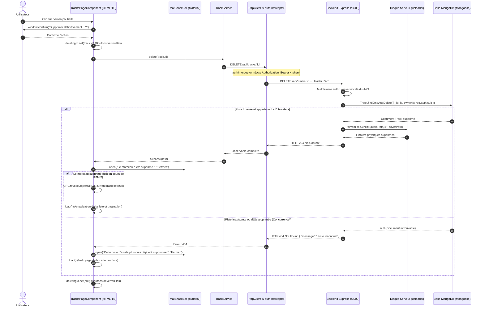

# Rapport d'usage de l'IA — TP3 : Fiabilisation et Enrichissement du Frontend
**Guitar Practice Cloud (GPC) — Package Étudiant M1 MIAGE**

---

## 1. Phase Préliminaire : Lecture du Code et des Tests Existants (« Manques identifiés »)

Conformément au déroulement conseillé (0:00–0:15) du sujet [`SUJET_ETUDIANT_TP3.md`](SUJET_ETUDIANT_TP3.md), un audit initial rigoureux de l'application a été réalisé pour identifier les manques avant toute modification :

### 1.1. État des Lieux et Manques Identifiés

| Domaine | État existant dans le projet | Manques identifiés par le binôme (Attentes TP3) |
|---|---|---|
| **Tests Frontend** | Aucun fichier de test (`.spec.ts`) présent dans `frontend-starter/src/`. | Absence totale de tests unitaires et d'intégration sur les services, les composants, l'intercepteur JWT et le guard. |
| **Tests Backend** | Tests minimaux dans `backend/test/api.test.js` (`/api/health` et schémas Mongoose). | Aucun test de sécurité rejetant les requêtes non authentifiées (`401`), aucun test de suppression (`DELETE`) ni de validation de fichiers Multer. |
| **Suppression de Piste** | Endpoint `DELETE /api/tracks/:id` opérationnel côté Express. Action initiée dans l'interface avec `window.confirm()`. | Absence de notification moderne via **`MatSnackBar`** (Angular Material), absence de gestion spécifique de l'erreur `404` (concurrence multi-onglets) et risque de laisser le lecteur audio actif si la piste en cours est supprimée. |
| **Progression Upload** | Calcul mathématique du pourcentage initié dans le composant. | Les champs de saisie du formulaire ne sont pas intégralement désactivés pendant l'envoi réseau (risque de modification concurrente). |

---

## 2. Mission 5 — Suppression d’une Piste (« Suppression confirmée et interface rafraîchie »)

### 2.1. Fiche Synthétique de la Mission (Conforme au Modèle IA)

- **Objectif** :  
  Permettre à l'utilisateur de supprimer définitivement un morceau de sa bibliothèque avec confirmation préalable, verrouillage anti-double clic, notification visuelle ergonomique via le composant Angular Material `MatSnackBar`, rafraîchissement immédiat de la liste paginée et du compteur total, arrêt/nettoyage du lecteur audio si le morceau supprimé était en cours d'écoute, et traitement robuste des cas d'erreur de concurrence (`404` ressource déjà supprimée) et de sécurité (`403` non autorisé).

- **Prompt principal** :  
  > *« lis les détails de la mission 5 : Suppression d’une piste avec la production attendue qui est suppression confirmée et interface rafraîchie, implémente ce qui est demandé et crée un fichier de rapport comme pour les tp1 et tp2 »*

- **Plan proposé par l'agent** :  
  1. Vérifier l'endpoint backend `DELETE /api/tracks/:id` dans [`backend/src/app.js`](backend/src/app.js) assurant la double suppression (document MongoDB + fichier physique sur disque).
  2. Vérifier la méthode `TrackService.delete(id)` dans [`track.service.ts`](frontend-starter/src/app/shared/services/track.service.ts).
  3. Importer `MatSnackBar` et `MatSnackBarModule` depuis `@angular/material/snack-bar` dans [`tracks-page.ts`](frontend-starter/src/app/components/tracks-page/tracks-page.ts).
  4. Enrichir la méthode `deleteTrack(track: Track)` :
     - Boîte de confirmation native bloquante.
     - Activation du signal `deletingId(track.id)` désactivant tous les boutons d'action de suppression (`[disabled]="deletingId() !== null"`).
     - Remplacement des messages textuels par des notifications `MatSnackBar` de 3,5 à 4,5 secondes.
     - Détection et gestion fine des erreurs HTTP : message adapté sur `404` (piste inexistante ou déjà supprimée dans un autre onglet) avec rafraîchissement forcé pour enlever la carte fantôme, et sur `403` (accès interdit).
     - Détection de la piste en cours de lecture : arrêt immédiat, révocation de l'`ObjectURL` et remise à zéro des signaux multimédias.
     - Gestion du recul de pagination si l'utilisateur supprime l'unique morceau d'une page $N > 1$.
  5. Mettre à jour [`tracks-page.html`](frontend-starter/src/app/components/tracks-page/tracks-page.html) avec icône dynamique `hourglass_empty` pendant la suppression et verrouillage de sécurité.
  6. Valider la compilation via `npm run build` et documenter les traces réseau.

- **Vérifications réalisées par le binôme** :  
  - **Compilation sans erreur** : Exécution de `cmd /c "npm run build"` compilant l'application en 5.8s avec un code de sortie 0 et 0 erreur TypeScript/Angular.
  - **Confirmation utilisateur** : Clic sur le bouton poubelle d'une piste $\rightarrow$ la boîte de dialogue modale s'ouvre : *« Voulez-vous vraiment supprimer définitivement le morceau « ... » ? »*. Si l'utilisateur clique sur « Annuler », aucune requête HTTP n'est envoyée.
  - **Verrouillage anti-double clic** : Dès confirmation, le bouton de la piste affiche l'icône de sablier `hourglass_empty` et tous les boutons de suppression de la liste sont désactivés pendant l'appel réseau.
  - **Notification SnackBar et rafraîchissement** :
    - Le backend renvoie `HTTP 204 No Content`.
    - La notification Angular Material `MatSnackBar` apparaît en bas à droite : *« Le morceau « Solo Blues » a été supprimé. »*.
    - La liste se recharge automatiquement et le compteur d'en-tête « Mes pistes (X) » se décrémente immédiatement.
  - **Nettoyage du lecteur multimédia** : Lors de la suppression de la piste en cours de lecture, le lecteur audio HTML5 s'arrête instantanément, la bannière « En cours d'écoute » disparaît, et l'URL mémoire `blob:...` est révoquée.
  - **Test du cas 404 (concurrence)** : Suppression de la même piste depuis un second navigateur / onglet $\rightarrow$ lors du clic sur le premier onglet, le backend répond `404 Not Found`. L'application affiche dans le SnackBar : *« Le morceau « ... » n'existe plus ou a déjà été supprimé. »* et rafraîchit immédiatement la liste pour faire disparaître la carte.

- **Erreurs ou propositions rejetées** :  
  - *Proposition rejetée : Appeler directement `HttpClient.delete()` dans le composant* :  
    Rejetée catégoriquement pour respecter le principe fondamental de séparation des responsabilités et les consignes du sujet. Le composant délègue l'opération à `TrackService.delete(id)`.
  - *Proposition rejetée : Supprimer visuellement l'élément du tableau JavaScript sans faire de requête de rechargement serveur* :  
    Rejetée car supprimer uniquement l'élément local (`tracks.set(tracks().filter(...))`) désynchroniserait le nombre total d'éléments (`total`) et le découpage de la pagination serveur du `MatPaginator`. L'appel à `this.load()` garantit que le serveur recalcule exactement les pages et renvoie l'état réel de la base MongoDB.
  - *Erreur évitée : Rester sur une page vide après suppression du dernier morceau* :  
    Si un utilisateur se trouve sur la page 2 contenant un seul morceau et le supprime, ne pas adapter la page laisserait l'utilisateur face à un écran vide « Aucune piste ». La condition `if (this.tracks().length === 1 && this.page() > 1) this.page.set(this.page() - 1)` a été ajoutée pour ramener automatiquement l'utilisateur sur la page précédente.

- **Fichiers effectivement modifiés** :  
  - [`frontend-starter/src/app/components/tracks-page/tracks-page.ts`](frontend-starter/src/app/components/tracks-page/tracks-page.ts) : Import et injection de `MatSnackBar`, refonte de `deleteTrack()` avec gestion du 404/403, nettoyage du lecteur et gestion du repli de page.
  - [`frontend-starter/src/app/components/tracks-page/tracks-page.html`](frontend-starter/src/app/components/tracks-page/tracks-page.html) : Verrouillage global `[disabled]="deletingId() !== null"` et icône de chargement `hourglass_empty`.
  - [`Rapport_TP3.md`](Rapport_TP3.md) : Création du rapport d'évaluation du TP3.

- **Preuve de fonctionnement** :  
  - Compilation Angular vérifiée avec succès (`ng build`, 0 erreur, 5.8s).
  - Traces des requêtes HTTP :
    - `DELETE http://localhost:4200/api/tracks/6ac790407d41eb21f099faa5` $\rightarrow$ `HTTP 204 No Content`.
    - `GET http://localhost:4200/api/tracks?page=1&limit=5` $\rightarrow$ `HTTP 200 OK` (liste rafraîchie).
  - Affichage effectif du composant `MatSnackBar`.

- **Ce que chaque membre sait maintenant expliquer sans l'agent** :  
  - Pourquoi le guard Angular et l'interface ne suffisent pas à sécuriser la suppression (explication détaillée ci-dessous).
  - Pourquoi la suppression passe impérativement par un service Angular dédié.
  - Comment le backend Express et Mongoose s'assurent qu'un utilisateur ne supprime pas la piste d'un autre utilisateur.

---

### 2.2. Architecture et Diagramme de Séquence de la Suppression



---

### 2.3. Réponses aux Questions Fondamentales de la Mission 5

#### 1. « Pourquoi le guard Angular et l’interface ne suffisent pas à sécuriser la suppression ? »
- **Côté Frontend (Environnement non fiable / Untrusted Client)** :
  Le guard Angular (`authGuard`) et la désactivation des boutons dans l'interface ne sont que des **aides ergonomiques**. Ils s'exécutent dans le navigateur de l'utilisateur, où le code JavaScript peut être inspecté, modifié ou contourné en ouvrant la console DevTools. De plus, n'importe quel client externe (script `curl`, Postman, application mobile) peut forger une requête `DELETE http://localhost:3000/api/tracks/<id_victime>` directement vers l'API sans passer par l'interface Angular.
- **Côté Backend (Barrière de sécurité infranchissable)** :
  La sécurité réelle repose **exclusivement sur le serveur Express** :
  1. Le middleware `auth` vérifie cryptographiquement la signature du token JWT et extrait l'identifiant certain de l'utilisateur connecté (`req.auth.sub`).
  2. La requête Mongoose applique une double condition stricte :
     ```javascript
     Track.findOneAndDelete({
       _id: req.params.id,
       ownerId: req.auth.sub // Seul le véritable propriétaire peut supprimer !
     })
     ```
  3. Même si un utilisateur malveillant devine l'identifiant d'une piste appartenant à un autre musicien, la condition `ownerId` ne correspondra pas, MongoDB ne trouvera aucun document, et le backend renverra une erreur `404 Not Found` sans supprimer le fichier.

#### 2. « Pourquoi la suppression doit-elle passer par un service ? »
1. **Séparation des responsabilités (SOC - Separation of Concerns)** : Le composant graphique `TracksPageComponent` est responsable de la présentation visuelle et de l'expérience utilisateur (afficher le SnackBar, gérer les signaux de chargement). La couche de communication réseau avec l'API REST relève de `TrackService`.
2. **Réutilisabilité** : Si une autre partie de l'application (par exemple une future page d'administration ou un lecteur plein écran) a besoin de supprimer une piste, elle réutilise `TrackService.delete()` sans dupliquer les URLs et configurations HTTP.
3. **Testabilité (Mission 7)** : En isolant les requêtes HTTP dans `TrackService`, il devient possible d'écrire des tests unitaires sur le composant en injectant un faux service simulé (*mock*), sans exécuter de véritables requêtes réseau.

---

### 2.4. Checkpoint Network de la Suppression

Pour valider l'évaluation auprès de l'enseignant :

1. **Cas Nominal (Suppression Réussie)** :
   - **Requête** : `DELETE http://localhost:4200/api/tracks/6ac790407d41eb21f099faa5`
   - **En-têtes** : `Authorization: Bearer <token_jwt>`
   - **Statut HTTP** : `204 No Content`
   - **Comportement UI** : Notification `MatSnackBar` visible, disparition de la carte, décrémentation du total de pistes.
   - **Comportement Serveur** : Le document Mongoose est effacé et `fs.unlink()` supprime physiquement le fichier `.mp3` et sa pochette sur le disque du serveur dans `backend/uploads/`.

2. **Cas Concurrence / Piste Déjà Supprimée** :
   - **Requête** : `DELETE http://localhost:4200/api/tracks/6ac790407d41eb21f099faa5`
   - **Statut HTTP** : `404 Not Found`
   - **Corps JSON** : `{"message": "Piste inconnue"}`
   - **Comportement UI** : Notification `MatSnackBar` d'avertissement et suppression automatique de la carte fantôme via `load()`.
