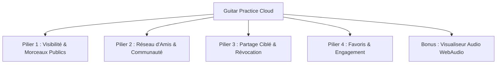

# Spécifications du Projet Global — Guitar Practice Cloud (GPC)

> **Auteur :** **Elhadj Oumar DIALLO** — Master 1 MIAGE (2026–2027)  
> **Projet :** Guitar Practice Cloud — Plateforme Sociale de Partage Audio pour Musiciens  
> **Cadre :** TP4+ et Mini-Projet d'approfondissement (Architecture Fullstack Angular & Node.js/Express)  
> **Statut :** Document de cadrage de référence (évolutif et modulaire)

---

## 1. Vision et Objectifs du Projet

### 1.1 Contexte
Dans le cadre des TP1, TP2 et TP3, le socle de base de l'application **Guitar Practice Cloud** a été solidifié :
- Authentification JWT avec intercepteur et persistance réactive (Signals Angular) ;
- Gestion du profil utilisateur ;
- Téléversement multipart et streaming sécurisé de morceaux audio avec pochettes ;
- Pagination serveur, filtres de recherche et suppression sécurisée avec snackbars ;
- Tests automatisés frontend (Vitest) et backend (`node --test`), plus un thème sombre immersif.

### 1.2 Problématique & Orientation choisie
Le sujet du TP4+ offre une grande liberté d'orientation entre une voie acoustique pure (effets et filtres WebAudio) et une voie orientée **Plateforme collaborative & Fichiers publics/privés**.

**Orientation retenue : "Social Music Cloud" (Partage de fichiers publics/privés & Réseau d'entraide musicale)** :
- **Alignement MIAGE optimal** : met en valeur la conception logicielle, les règles de contrôle d'accès (RBAC / ACL), les relations de données MongoDB, l'architecture d'API RESTful et l'ergonomie UX/UI réactive.
- **Zéro barrière musicale** : le projet ne nécessite aucune connaissance préalable en solfège ou traitement acoustique complexe.
- **Clin d'œil visuel WebAudio** : intégration d'un visualiseur de fréquences audio automatique (Canvas HTML5) pour valoriser le lecteur auprès du professeur sans complexité superflue.

---

## 2. Périmètre Fonctionnel Détaillé

Le projet s'articule autour de 4 piliers fonctionnels majeurs, complétés par une touche visuelle audio :



### Pilier 1 : Visibilité & Morceaux Publics vs Privés
1. **Choix de visibilité à l'upload** :
   - Chaque morceau possède un attribut de visibilité : `Public` 🌍 (accessible à toute la communauté) ou `Privé` 🔒 (accessible uniquement à son propriétaire et ses amis autorisés).
   - Par défaut, un morceau est `Privé`.
2. **Page / Onglet "Explorer la Communauté"** :
   - Consultation des morceaux publics partagés par tous les utilisateurs inscrits.
   - Section mise en valeur : **"Récemment partagés"** (les 5 derniers morceaux publics).
   - Recherche textuelle transversale dans le catalogue public (titre, artiste).
3. **Indicateurs visuels clairs** :
   - Badges colorés distinctifs sur chaque carte de morceau (`Public` vert / `Privé` ambre).
   - Bascule de statut en un clic pour le propriétaire (passer de privé à public ou inversement).

### Pilier 2 : Réseau Social & Gestion des Amis
1. **Annuaire des musiciens** :
   - Page dédiée "Communauté / Amis".
   - Recherche d'utilisateurs par nom ou email.
2. **Système d'amitié asynchrone** :
   - Bouton « Demander en ami ».
   - Gestion des statuts : `En attente (Pending)`, `Accepté (Accepted)`, `Refusé (Rejected)`.
   - Notifications / pastilles visuelles pour les demandes reçues.
3. **Vue "Mes Amis"** :
   - Liste des amis confirmés avec leur date de connexion/inscription.
   - Possibilité de retirer un ami en un clic.

### Pilier 3 : Partage Ciblé de Morceaux Privés & Révocation
1. **Partage sélectif** :
   - Sur un morceau privé, le propriétaire peut cliquer sur un bouton « 👥 Partager ».
   - Une modale ergonomique permet de cocher les amis autorisés à écouter ce morceau.
2. **Révocation instantanée** :
   - Le propriétaire voit la liste des amis ayant actuellement accès et peut révoquer l'accès individuellement ou globalement à tout moment.
3. **Espace "Partagés avec moi"** :
   - Onglet ou filtre permettant à un utilisateur de retrouver tous les morceaux privés que ses amis lui ont confiés.

### Pilier 4 : Favoris & Statistiques d'Écoute
1. **Système de "J'aime" / Favoris (❤️)** :
   - Possibilité de marquer n'importe quel morceau accessible (public ou partagé) comme favori.
   - Filtre rapide "Mes Favoris" dans la bibliothèque.
2. **Compteur d'écoutes** :
   - Incrémentation sécurisée lors du déclenchement de la lecture audio.
   - Affichage du nombre d'écoutes sur la carte du morceau.

### Pilier 5 : Visualiseur Audio Animé (Bonus Valorisation)
1. **Animation en temps réel sur le lecteur** :
   - Lors de la lecture d'un morceau, affichage d'un spectre audio réactif dans un canvas HTML5 intégré au bandeau lecteur.
   - Utilise l'API standard `AudioContext` et `AnalyserNode` du navigateur (aucun calcul musical manuel requis).

---

## 3. Architecture Technique et Données

### 3.1 Backend (Node.js / Express / Mongoose)

#### Évolution du Modèle `Track` (`backend/src/models/Track.js`)
```javascript
// Nouveaux champs à intégrer dans le schéma existant
{
  isPublic: { type: Boolean, default: false, index: true },
  sharedWith: [{ type: mongoose.Schema.Types.ObjectId, ref: 'User' }],
  likes: [{ type: mongoose.Schema.Types.ObjectId, ref: 'User' }],
  listenCount: { type: Number, default: 0, min: 0 }
}
```

#### Nouveau Modèle `Friendship` (`backend/src/models/Friendship.js`)
```javascript
{
  requesterId: { type: mongoose.Schema.Types.ObjectId, ref: 'User', required: true, index: true },
  recipientId: { type: mongoose.Schema.Types.ObjectId, ref: 'User', required: true, index: true },
  status: { 
    type: String, 
    enum: ['pending', 'accepted', 'rejected'], 
    default: 'pending',
    index: true 
  }
}
// Index d'unicité pour éviter les doublons de demande
schema.index({ requesterId: 1, recipientId: 1 }, { unique: true });
```

#### Nouvelles Routes RESTful
- **Morceaux & Visibilité** :
  - `GET /api/tracks/public` : liste paginée des morceaux publics avec filtre de recherche et tri par date.
  - `GET /api/tracks/recent-public` : les 5 derniers morceaux publics pour la bannière d'accueil.
  - `PATCH /api/tracks/:id/visibility` : bascule `isPublic` (réservé au propriétaire).
  - `GET /api/tracks/shared-with-me` : morceaux privés partagés avec l'utilisateur connecté.
  - `POST /api/tracks/:id/share` : partager avec une liste d'utilisateurs (`{ userIds: [...] }`).
  - `DELETE /api/tracks/:id/share/:userId` : révoquer le partage d'un utilisateur.
  - `POST /api/tracks/:id/like` : toggle favori (like/unlike).
  - `POST /api/tracks/:id/listen` : incrémenter le compteur d'écoutes.
- **Réseau d'amis** :
  - `GET /api/users/search?q=...` : recherche d'utilisateurs par nom ou email.
  - `GET /api/friends` : liste des amis confirmés et des demandes en attente.
  - `POST /api/friends/request/:recipientId` : envoyer une demande d'ami.
  - `PATCH /api/friends/request/:friendshipId` : accepter ou refuser (`{ action: 'accept' | 'reject' }`).
  - `DELETE /api/friends/:friendId` : supprimer un ami.

### 3.2 Frontend (Angular 22 Standalone)
- **Composants ciblés** :
  - `CommunityPageComponent` : onglets "Explorer (Public)", "Morceaux Récents", "Partagés avec moi".
  - `FriendsPageComponent` : annuaire des utilisateurs, gestion des invitations reçues/envoyées, liste d'amis.
  - `ShareModalComponent` : dialogue Angular Material pour gérer les autorisations d'un morceau privé.
  - `AudioVisualizerComponent` : visualiseur Canvas synchronisé avec la balise `<audio>`.
- **Services modulaires** :
  - `FriendService` : requêtes HTTP pour l'amitié et les utilisateurs.
  - `TrackService` étendu : méthodes dédiées aux pistes publiques, partages et likes.
  - Signaux réactifs pour l'actualisation instantanée sans rechargement de page.

---

## 4. Découpage du Projet en 5 Phases Opérationnelles

Pour avancer de manière méthodique, sereine et sans risque de régression :

| Phase | Intitulé | Livrables Principaux | Tests Associés |
|:---:|---|---|---|
| **Phase 1** | **Visibilité Public / Privé & Catalogue Communautaire** | • Champ `isPublic` en base<br>• Sélecteur Public/Privé à l'upload<br>• Onglet "Explorer" et bannière "Récemment ajoutés"<br>• Toggle de visibilité en 1 clic | • Tests unitaires du modèle Track<br>• Tests de la route `GET /api/tracks/public`<br>• Test d'affichage UI |
| **Phase 2** | **Réseau Social & Gestion des Amis** | • Modèle Mongoose `Friendship`<br>• Routes d'invitation, acceptation, suppression<br>• Page "Communauté" avec recherche d'utilisateurs et statut d'amitié | • Tests backend de création/acceptation d'amitié<br>• Tests de non-duplication<br>• Tests du service Angular |
| **Phase 3** | **Partage Ciblé de Pistes Privées & Révocation** | • Champ `sharedWith` et contrôle d'accès au streaming audio<br>• Modale de partage avec sélection des amis<br>• Vue "Partagés avec moi"<br>• Révocation d'accès instantanée | • Tests de sécurité (un non-ami ne peut pas streamer un morceau privé)<br>• Test de révocation de droit |
| **Phase 4** | **Favoris (Likes) & Compteur d'Écoutes** | • Système de Like avec signal réactif<br>• Filtre "Mes Favoris"<br>• Incrément du nombre d'écoutes | • Tests du toggle de like<br>• Tests de persistance |
| **Phase 5** | **Visualiseur Audio WebAudio & Rapport Final** | • Composant Canvas avec `AnalyserNode`<br>• Tests globaux de non-régression<br>• Rédaction du rapport complet `REPORT.md` | • `npm test` front (Vitest)<br>• `npm test` back (`node --test`)<br>• Validation `ng build` |

---

## 5. Méthodologie et Règles d'Or pour Travailler avec l'Agent

1. **Une seule phase à la fois** : Ne jamais démarrer la Phase suivante avant que la Phase courante ne soit terminée, testée et validée.
2. **Zéro régression sur les TPs 1, 2 et 3** : Les fonctionnalités existantes (connexion, upload multipart avec pochettes, pagination serveur, suppression avec snackbar, dark mode) doivent continuer de fonctionner parfaitement.
3. **Tests automatisés systématiques** : À chaque phase, ajouter les tests unitaires correspondants (frontend Vitest et backend).
4. **Mise à jour incrémentale de `REPORT.md`** : Rédiger le rapport au fur et à mesure pour garder une trace fraîche des choix d'architecture, des captures d'écran et des tests.
5. **Validation visuelle** : Vérifier chaque fonctionnalité directement dans le navigateur avant de valider l'étape.

---

## 6. Checklist Opérationnelle Détaillée (Micro-Tâches Pas à Pas)

> 💡 **Principe de gouvernance :** Chaque case `[ ]` représente une sous-tâche atomique. L'agent ne passe à la sous-tâche suivante qu'après explication claire, exécution et accord explicite de l'étudiant.

### 🟢 Phase 1 : Visibilité Public / Privé & Catalogue Communautaire
- [ ] **1.1 Backend :** Ajout du champ `isPublic: { type: Boolean, default: false }` dans [Track.js](backend/src/models/Track.js) et mise à jour de `toPublic()`.
- [ ] **1.2 Backend :** Création des endpoints `GET /api/tracks/public` (avec recherche & pagination) et `PATCH /api/tracks/:id/visibility`.
- [ ] **1.3 Backend :** Tests unitaires du modèle et des routes publiques (`node --test`).
- [ ] **1.4 Frontend :** Mise à jour du formulaire d'upload avec le sélecteur `Public 🌍 / Privé 🔒`.
- [ ] **1.5 Frontend :** Badges de statut visuels sur chaque morceau et bascule de visibilité en 1 clic pour le propriétaire.
- [ ] **1.6 Frontend :** Onglet ou vue "Explorer la Communauté" avec la section "Récemment partagés".
- [ ] **1.7 Tests Frontend & Validation :** Tests Vitest (`npm test`), vérification visuelle navigateur et captures d'écran.

### 🟢 Phase 2 : Réseau Social & Gestion des Amis
- [ ] **2.1 Backend :** Création du modèle Mongoose `Friendship.js` (requester, recipient, status, index unique anti-doublon).
- [ ] **2.2 Backend :** Routes d'amitié : recherche d'utilisateurs (`GET /api/users/search`), envoi de demande (`POST /api/friends/request`), acceptation/rejet (`PATCH /api/friends/request/:id`), suppression (`DELETE /api/friends/:id`).
- [ ] **2.3 Backend :** Tests unitaires des règles d'amitié et des permissions.
- [ ] **2.4 Frontend :** Création du service Angular `FriendService`.
- [ ] **2.5 Frontend :** Interface "Communauté & Amis" : barre de recherche de musiciens, onglet "Invitations reçues", liste "Mes Amis".
- [ ] **2.6 Tests Frontend & Validation :** Tests Vitest des flux d'amitié et vérification navigateur.

### 🟢 Phase 3 : Partage Ciblé de Pistes Privées & Révocation
- [ ] **3.1 Backend :** Ajout du champ `sharedWith` dans `Track.js` et sécurisation du streaming audio `GET /api/tracks/:id/stream` (propriétaire OU piste publique OU ami autorisé).
- [ ] **3.2 Backend :** Endpoints de partage : `POST /api/tracks/:id/share` et `DELETE /api/tracks/:id/share/:userId`.
- [ ] **3.3 Frontend :** Modale de partage ergonomique (liste des amis à cocher/décocher).
- [ ] **3.4 Frontend :** Vue / filtre dédié "Partagés avec moi" dans la bibliothèque.
- [ ] **3.5 Tests & Validation :** Tests de sécurité (interdiction formelle d'accès aux utilisateurs non autorisés).

### 🟢 Phase 4 : Interactions Communautaires & Favoris (Likes)
- [ ] **4.1 Backend :** Champ `likes` et `listenCount` dans `Track.js`, endpoints `POST /api/tracks/:id/like` et `POST /api/tracks/:id/listen`.
- [ ] **4.2 Frontend :** Bouton réactif ❤️ Like sur les morceaux, filtre rapide "Mes Favoris", badge du compteur d'écoutes.
- [ ] **4.3 Tests & Validation :** Tests unitaires de la persistance des likes et écoutes.

### 🟢 Phase 5 : Visualiseur Audio WebAudio & Rapport Final
- [ ] **5.1 Frontend :** Composant `AudioVisualizerComponent` en Canvas HTML5 connecté au flux `<audio>` via `AudioContext` et `AnalyserNode`.
- [ ] **5.2 Frontend :** Intégration esthétique dans le lecteur audio en bas de page.
- [ ] **5.3 Tests Globaux de Non-Régression :** Suite complète frontend (Vitest) et backend (`node --test`), validation du build `ng build`.
- [ ] **5.4 Rapport d'Évaluation :** Rédaction soignée du rapport final `REPORT.md` (architecture, captures, justifications pour la soutenance).

